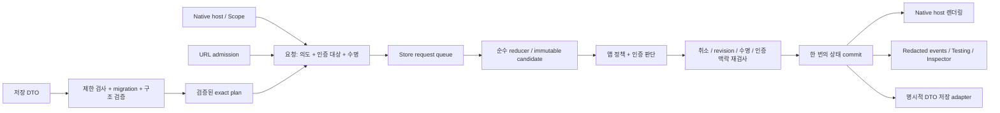

# InnoRouter 7.0.0 전체 개선 계획

> 이 문서는 2026-10-04의 PR #54 검토 기준으로 작성한 보존용 Draft다. 2026-10-19 최신 main에 기록했으며, 현재 구현·출시 상태나 새 작업 승인을 나타내지 않는다. 현재 지원 버전과 계약은 [README](../README.md)와 [RELEASING](../RELEASING.md)을 따른다.

**확정 방향: 중간 6.1.1 출시 없이 바로 7.0.0으로 전환한다.** 확인된 결함 수정, 요청·수명 계약, 재귀 모달, 영속성, API·성능 개선을 하나의 7.0.0 개발 주기에 포함한다. 구현은 작은 slice로 나누되 모든 변경의 출시 대상은 7.0.0이다.

**성과 목표는 기술 평가 92/100 이상이면서, 같은 기준의 Swift Navigation보다 5점 이상 높은 결과다.** 생태계·인지도는 제외하고 기본 탐색·타입 안전성·수명·API 조합·성능·호환성과 복원·진단을 검증한다. 평가 규칙과 필수 조건은 [기술 평가 계약](7.0.0-technical-scorecard.ko.md)에 고정한다. 목표 수치는 측정된 점수가 아니다.

사용자가 2026-10-04에 직접 7.0.0 전환과 기술 점수 우위 목표를 지정했다. 이 두 방향은 결정되었지만 상세 설계는 Draft이며, 계획 수정이 제품 구현·원격 PR 변경·실제 출시 승인을 뜻하지 않는다.

## 1. 범위와 기준

| 항목 | 기준 |
|---|---|
| 기준 PR | [InnoRouter #54](https://github.com/InnoSquadCorp/InnoRouter/pull/54), `release/6.1.1` |
| 목표 출시 | **7.0.0 직접 전환**. 위 6.1.1 branch 이름은 검토 입력의 이력이며 별도 patch 출시 단계가 아님 |
| 코드 기준 | `0f0727134d937799ce4c2ea5116ee75a228375f0` |
| rebase 기준 main | `5d67726cc38634cd15e1ccbd62289969168d8370` |
| 이번 계획 수정 시 확인 | 위 HEAD 유지. 기존 untracked 계획 문서만 있는 상태에서 같은 문서 수정 및 기술 평가 계약 추가 |
| 기존 검토 증거 | 2026-10-04 PR 검토의 결함 재현, 대조군, 전체 테스트·성능·consumer 결과를 재사용 |
| 범위 | 세 public products, Core/SwiftUI/DeepLink/System/Macros/Testing/Inspector, 예제·consumer·CI·release, Swift Navigation 동일 조건 기술 비교 |
| 제품 방향 | macro-first, SwiftUI native host, 단일 Store, 순수 reducer, 원자적 commit 유지 |
| 지원 기준 | Swift 6.3+, iOS/iPadOS 18+, macOS 15+, tvOS 18+, watchOS 11+, visionOS 2+ 유지 제안; Mac Catalyst 검증 포함 |
| 책임 | 구현·검증은 InnoRouter maintainer, 앱별 route schema·인증 맥락·수용 검증은 해당 consumer maintainer |
| 문서 깊이 | expanded: 공개 API, 인증 대상, 수명, 영속 데이터 migration의 변경 비용이 큼 |

현재 제품 계약은 [v6 전략](v6-functional-strategy.md), [기능 명세](functional-expansion-spec.md), [기존 기술 계획](functional-expansion-technical-plan.md), [릴리스 계약](../RELEASING.md)을 기준으로 한다. 기존 문서는 6.x의 역사적 계약으로 유지하고, S01에서 승인된 7.0 요구사항과 대체되는 조항을 명시한다.

전체 검토 증거는 [PR54 검토 보고서](/Users/changwooson/Developer/InnoSquad/ReviewArtifacts/InnoRouter-PR54-2026-10-04/REVIEW.ko.md)에 있다. 이 계획에서는 테스트와 원격 CI를 다시 실행하지 않았다. 이전 CI snapshot은 당시 상태이며 새 구현의 통과 증거로 사용할 수 없다.

### 증거와 미확인 경계

| 구분 | 확인 내용 / 처리 |
|---|---|
| 확인된 제품 결함 F1 · P1 | 보호 route를 탭 선택 plan으로 변환하면 원래 인증 대상이 사라짐. 공개 API 재현과 stack/login 대조군 있음. S00 회귀 확보, S03까지 필수 해결 |
| 확인된 제품 결함 F2 · P2 | 탭 선택을 예약한 뒤 root를 복원으로 교체하면 오래된 요청이 새 container를 변경함. 실제 내부 host 함수 재현과 정상·mismatch 대조군 있음. S00 회귀 확보, S03까지 필수 해결 |
| 확인된 문서 결함 F3 · P3 | CHANGELOG의 SwiftSyntax pin 603.0.2 설명과 실제 604.0.0 lock 불일치. 지원 하한과 pin 구분. S00 필수 수정 |
| 추가 기능·설계 개선 | 재귀 모달, 검증된 상태, 영속 DTO, 기본 제한, 공개 오류 확장 계약은 제안이다. 현재 동작 전부를 결함으로 분류하지 않음 |
| 미해결 결함 후보 | 기존 검토에서 별도로 남긴 후보 없음. 음수 event buffer의 crash 가설은 당시 실험에서 재현되지 않아 제외 |
| 재사용 검증 | root 714 tests/88 suites, CI 정책 91 tests, macro expansion/behavior, DocC/API/consumer, native macOS allow/reject/cancel, Release smoke 7개 |
| 도구 경계 | 위 로컬 결과는 Xcode 27 / Swift 6.4 / SwiftSyntax 604. Swift 6.3 호환성과 모든 OS 동작을 대신 증명하지 않음 |
| 미확인 | 새 변경의 exact-SHA CI, 모든 지원 native platform, 실제 소비 앱 migration, 실기기 gesture/접근성, 경쟁군 동일 조건 실행 비교 |

기준 인벤토리는 3개 공개 library products, Sources 아래 13개 디렉터리(진단·성능 executable 포함), Swift 소스 147개, 테스트 파일 83개다. 숫자는 당시 규모를 설명하며 개선 목표나 품질 지표로 사용하지 않는다.

### 이번 개선의 제외 범위

인증 서비스·서버 접근 제어, 앱의 business state, UIKit/AppKit controller 소유권, 5.x의 여러 Store 복원, 별도 analytics 전송, 무관한 프레임워크 수정은 포함하지 않는다. UIKit/AppKit의 얇은 상태 연결은 기술 비교 범위에 포함한다. OS 지원 하한 변경은 자동 포함하지 않으며 호환성 점수와 확장 비용을 기록한다. 실제 소비 앱 변경은 해당 저장소 범위가 정해진 뒤 수행한다. macro/build graph 측정과 비용 개선은 필수이고, 새 runtime-only product/trait의 도입 방식은 측정 후 결정한다.

## 2. 성공해야 하는 사용자 시나리오

| ID | 시나리오 | 완료 조건 |
|---|---|---|
| R01 | 로그아웃 상태에서 보호된 탭·split·scene 링크 열기 | route→plan 변환과 host arbitration을 지나도 인증 대상 유지. 인증 전 적용 없음. 로그인 후 재검증하여 한 번 적용 |
| R02 | 링크 인증 또는 policy 대기 중 logout·root 교체·scene 종료 | 만료된 권한 맥락·수명으로 commit하지 않음. 결과와 진단이 한 번 종결됨 |
| R03 | 시트 → 시트 내부 push → 하위 시트 → typed result 반환 | 하나의 Store와 snapshot으로 표현. 자식 변화가 부모 stack을 오염시키지 않음 |
| R04 | R03 상태에서 부모 모달 닫기·호출자 취소·policy 거절 | 하위 요청과 waiter가 정해진 순서로 정리되고, 결과 중복·고아 continuation 없음 |
| R05 | 탭·split·중첩 모달·다중 창 상태 저장 후 재실행 | 그래프와 선택 상태 복원. 과거 권한·callback·waiter를 부활시키지 않음 |
| R06 | route case rename, tab 재정렬·현지화, 앱 schema 변경 | 명시적 안정 ID와 migration으로 호환. 지원하지 않는 데이터는 원본 보존 후 설명 가능한 실패/복구 |
| R07 | 과대·깊은·손상 snapshot/pending link, 느린 policy, queue overflow | 명시된 자원 한계에서 종료. 부분 commit·무제한 누적·민감 payload 로그 없음 |
| R08 | 처음 도입하는 앱과 기존 6.x 앱 | 기본 `@Router` 경험 유지. migration guide의 예제가 실제 외부 consumer에서 컴파일·실행됨 |
| R09 | 동작 비교와 릴리스 판단 | 공통 시나리오·조건·SHA에 연결된 자료로 재평가. 로컬 PASS/CI PASS/소비 앱 수용/출시 상태를 구분 |
| R10 | Swift Navigation보다 높은 기술 평가 | 기술 총점 ≥92, 같은 기준 상대 대비 ≥5점. 공통 핵심 그룹도 동등 이상이며 필수 correctness·비용·재현성 조건 모두 통과 |

## 3. 목표 구조와 불변식

다음은 **제안 구조**이며 현재 구현을 나타내는 그림이 아니다. 기존 연결점은 `RouterLinkPipeline.swift`, `RouterScope.swift`, `RouterStore+ExecutionAdmission.swift`, `RouterStore+Policy.swift`, `RouterState.swift`, `RouterSnapshot.swift`다.

계속 유지할 계약:

1. `RouterStore`만 변경 권한을 가진다. child scope, presentation, scene은 같은 상태 트리의 투영이다.
2. reducer는 동기적이고 순수하다. policy는 immutable candidate를 검사한다.
3. 변경을 승인하면 상태 assignment와 revision 증가가 각각 한 번이다. unchanged·거절·취소에는 둘 다 없다.
4. `RouterAction`은 점진적 변경, `RouterPlan`은 exact target이다. 세 번째 탐색 명령 체계를 공개하지 않는다.
5. 검증된 plan도 실행 권한을 보증하지 않는다. 적용 시점의 수명과 policy를 통과해야 한다.
6. 입력 출처, 인증 대상, 수명, transition ID를 변환·대기·재개 중 잃지 않는다.
7. 영속 데이터는 상태·요청 의도를 저장한다. 인증 grant, 실행 closure, continuation, 실행 중 수명 토큰은 저장하지 않는다.
8. 기본 Inspector·event·error에는 route payload와 원본 URL query를 남기지 않는다.

## 4. 7.0.0 착수와 결함 회귀 기준: S00

현재 결함의 회귀 테스트를 먼저 확보하고 같은 7.0.0 개발 주기 안에서 해결한다. 호환 patch를 따로 만드는 작업이나 6.1.1 출시 gate는 두지 않는다. 단순 결함은 S00에서 바로 고치고, 새 public contract와 연결되는 부분은 S01/S03의 최종 모델에 통합하여 중복 구현을 줄인다.

| 작업 | 변경 범위 | 집중 검증 / 통과 기준 |
|---|---|---|
| S00-A · F1 | DeepLink의 내부 admission 결과에 원래 route와 plan을 함께 보존. direct `decide`와 SwiftUI link arbitration에 전달. 원래 대상과 plan의 모든 기존 검사 대상의 합집합으로 검사 | 기존 탭 재현이 로그아웃에서 pending으로 바뀜. 정상 stack·로그인·비보호 링크 통과. split/scene/custom planner, 중복 URL, pending 재개, host 경로 검증 |
| S00-B · F2 | 탭 callback의 실행 precondition과 S03 incarnation 계약을 연결. queue·policy 이후·deferred resume 검증. 필요한 rejection contract 변경은 7.0으로 설계 | restore 교체 race에서 새 root와 revision이 추가 변경되지 않음. 정상 tabs 선택 통과. await 중 교체, 취소, 다른 branch의 정상 변경 대조군 추가 |
| S00-C · F3 | 지원 하한/선택 pin 설명 수정, 버전 선언·CHANGELOG·release checklist를 7.0.0 개발 주기로 정렬 | root/consumer/native lock·manifest·문서 정합성, 과거 release 기록과 신규 7.0 기록 구분 |
| S00-D | 진단 probe를 회귀 테스트로 통합. PR54의 유효 변경을 7.0 기반에 보존하고 기준 evidence를 고정 | pre-fix가 의도한 결함으로 실패. S00 즉시 수정 또는 S03 통합 수정의 소유자·완료 조건 명확; 별도 6.1.1 출시는 없음 |

S00-B의 재현은 **다른 topology에 쓰지 않는 것**을 검증한다. tabs→다른 tabs의 동일 ID 재사용까지 S03 incarnation 계약으로 확장한다. `performRoot` 의미도 7.0의 명시적 소유권 계약으로 정리하고 migration을 제공한다. queue에 요청을 넣을 때 모든 요청의 global revision을 고정해 정상적인 직렬 실행까지 거절하는 방식은 피한다.

F1의 원래 URL을 두 번 해석하거나, 인증을 강제하려고 화면에 없는 가짜 route를 state에 넣지 않는다. breaking change는 7.0에서 허용하며 기존 형태를 억지로 보존하기 위한 임시 public API를 추가하지 않는다. 실제 branch/PR 전환은 구현 착수 시 최신 remote 상태를 확인한 뒤 수행한다.

## 5. 7.0 핵심 설계

아래 타입·필드 명칭은 설명용이며 공개 API 확정안이 아니다. S01에서 작은 consumer 코드로 검증한 뒤 최소 표면을 확정한다.

### 5.1 요청에 인증 대상과 실행 수명을 함께 보존

내부 request envelope가 action/plan, 출처, 원래 matched route, 인증 대상 descriptor, 실행 대상의 수명, correlation ID, deadline을 보유한다. 이를 별도 public command hierarchy로 확장하지 않는다.

인증과 수명은 서로 다른 검사다. 인증되었어도 오래된 scope에는 쓸 수 없고, scope가 살아 있어도 권한은 만료될 수 있다.

| 계약 | 제안 |
|---|---|
| 인증 대상 도출 | 원래 matched route + materialized plan routes + plan이 선택·활성화하는 tab/split/scene root의 선언 정보를 결합. 단순 scope ID로 변환하면서 root의 의미가 소실되지 않게 함 |
| plan-only resolver | macro 또는 검증된 manual catalog에서 선언 정보 해석. 인증이 필요한 구성에서 해석할 수 없는 대상은 fail closed. 호출자가 metadata를 생략해 보호를 우회할 수 없게 함 |
| 대상 범위 | 기존 whole-plan 검사에 포함된 route는 유지. catalog에만 있는 비활성 tab 전부를 무조건 인증 대상으로 추가하지 않음. 선택·활성화되는 root의 의미를 보완 |
| 적용 위치 | standalone pipeline 결과는 preflight다. Store에 적용할 때 동일 요청의 인증 요구를 검증. deep link/restore/direct plan 사이의 적용 우회 경로도 테스트 |
| 인증 맥락 | 앱이 제공하는 session/authorization generation으로 판단의 유효 범위를 표시. 인증 service·사용자 정보 자체는 라이브러리가 소유하지 않음 |
| 비동기 무효화 | 인증·policy 이후 commit 직전에 현재 generation 확인. logout·계정 전환이 generation을 갱신하면 오래된 결과 거절. 자동 재시도는 기본 없음 |
| durable pending | 의도와 필요한 target descriptor를 저장하고, 재개 시 현재 catalog·origin 정책·인증·topology를 다시 검증. 저장된 과거 허용 결과는 신뢰하지 않음 |
| 앱의 책임 | generation 갱신을 연결하지 않으면 외부 권한 변경을 라이브러리가 알아낼 수 없음. 이 제한을 adapter 계약과 consumer 테스트에 명시 |

로그인 UI를 기다리는 시간과 한 번의 비동기 인증 판정 시간을 분리한다. 전자는 bounded pending 상태로, 후자는 policy deadline으로 관리한다. 서버 접근 제어는 별도 앱·서버 책임이다.

### 5.2 topology와 수명을 표현하는 공통 계약

세 종류의 ID를 구분한다.

| 종류 | 예 | 저장 여부 / 의미 |
|---|---|---|
| 선언 ID | `account.tab`, `compose.flow`, route의 안정 key | 저장 가능. case rename·현지화와 독립적인 의미 |
| 논리 instance ID | 특정 window, presentation, node | snapshot에 저장 가능. 상태 그래프의 참조 일관성 유지 |
| 실행 incarnation | 현재 Store의 해당 instance가 살아 있는 기간 | 저장 금지. 제거·교체·복원 시 갱신하여 오래된 callback 무효화 |

host descriptor가 지원하는 root kind, branch ID, scene/presentation contract를 표현한다. Store는 `.apply`/restore 전에 구조 및 host 적합성을 확인하고 다음 중 명시된 결과를 제공한다: 적용, 거절, 앱이 지정한 migration/reconciliation, recovery 상태. 임의의 빈 scope ID로 조용히 동작을 무력화하는 처리를 공개 계약으로 삼지 않는다.

수명 규칙:

- 일반 push/pop, 같은 branch의 selection·badge 변경은 관계없는 scope를 만료시키지 않는다.
- subtree 제거·교체, 해당 모달/scene 종료는 그 하위 incarnation을 만료시킨다.
- exact restore는 영향을 받는 영역의 새 incarnation을 만든다. 같은 persisted ID라도 과거 callback 권한은 돌아오지 않는다.
- queue 실행 시작, 각 policy await 이후, commit 직전, deferral 재개 시 같은 수명을 검사한다.
- candidate를 만든 뒤의 revision staleness 검사는 유지한다. topology token으로 기존 원자성 검사를 대체하지 않는다.
- 의도적인 앱 root 전환은 owning Store의 명시적 root 요청으로 가능하게 한다. 오래된 child callback의 root 탈출과 구분한다.

### 5.3 presentation을 재귀적인 탐색 subtree로 확장

탐색 화면을 담는 presentation은 ID·route·style·options와 **child `RouterNode`**를 가진다. child의 기본 형태는 stack이며 같은 모델로 tab/split/custom container를 표현할 수 있게 설계한다. alert/dialog는 5.8의 같은 배타적 family에 속하되 탐색 subtree 대신 typed content/action을 가진다. `RouterScopePath`는 presentation 경계를 모호하지 않게 나타내야 한다. 문자열 scope ID에 예약 prefix를 붙이는 우회는 피한다.

부모 stack의 가려진 경로 진행은 현재처럼 막고, presentation 내부의 child stack push는 허용한다. 각 stack에 활성 presentation은 하나이며, 중첩은 그 자식 subtree에서 발생한다. 동시에 표시할 수 없는 modal queue를 상태로 만들지 않는다.

| 상황 | 정의할 동작 |
|---|---|
| child push/pop | 정확한 child scope만 변경. 부모 path와 sibling stack 보존 |
| 하위 모달의 value 반환 | 해당 presentation의 waiter에만 한 번 전달. 부모 waiter에는 전파하지 않음 |
| 부모의 interactive dismiss | dismiss가 승인되면 해당 모달은 dismissed, 하위에서 대기 중인 waiter는 cancelled. 하위 요청·deferral도 한 번 종결 |
| value 반환 중 부모 종료 | 먼저 commit된 terminal 전이가 소유권을 가짐. 늦게 도착한 값은 재전달하지 않음 |
| dismissal policy 거절·defer | subtree와 waiter를 먼저 지우지 않음. 승인된 실제 상태 전이에서 정리 |
| 외부 native scene 종료 | 기존 scene reconciliation 계약과 결합하여 실제 종료 후 살아 있지 않은 UI 소유권 정리 |
| restore된 presentation | 화면 상태는 복원하되 과거 task/waiter는 만들지 않음. 새 awaiting 호출과 구분된 결과 처리 |
| popover/compact/platform 차이 | 현재 capabilities 정책을 확장. 지원되는 native 표현 또는 명시적 거절/적응 event, 조용한 상태 유실 없음 |

renderer, reducer, state validation, deep-link traversal, snapshot, diff/history, Inspector, Testing을 같은 subtree 의미로 갱신한다. iOS만 그려지는 모델을 완성된 기능으로 처리하지 않는다.

### 5.4 검증된 상태와 구성용 입력을 분리

`RouterState`의 외부 관찰은 읽기 전용으로 만들고, 구성용 builder/draft에서 throwing validation을 거쳐 state/plan을 만든다. 내부 reducer는 이미 검증된 값의 불변식을 보존한다. 작은 stack/tab 선언에는 간단한 convenience 경로를 유지한다.

검증 항목은 중복 ID, 없는 selection, 잘못된 split 구성, scene/catalog 불일치, 잘못된 presentation 옵션, resource budget, graph의 참조·순환·소유권이다. 외부 데이터 오류가 Store initializer의 `precondition` trap으로 이어지지 않게 한다. 개발자의 불가능한 내부 불변식 위반에 사용하는 assertion과 입력 오류를 구분한다.

Swift에서 복사한 `RouterState`를 임의 수정해 invalid value를 만들던 경로는 breaking change로 정리한다. builder가 유효성을 검증해도 그 plan의 실행 정책·현재 수명 검사는 별도로 남는다.

### 5.5 영속 포맷을 runtime 모델에서 분리

새 snapshot envelope는 라이브러리 **format version**, 앱 **schema ID/version**, 제한된 payload를 구분한다. 현재 `RouterSnapshotCodec.currentVersion`은 앱이 선택하는 값이므로 기존 모든 snapshot을 일괄적으로 “schema 1”이라 가정하지 않는다. 현재 pending-link envelope의 고정 version 1도 별도 legacy adapter가 처리한다.

제안하는 graph DTO는 node/route/presentation record와 ID 참조를 갖는 평탄한 구조다. 범위가 제한된 테이블을 읽고 순환·중복 소유·dangling reference를 검사한 뒤 runtime의 재귀 값으로 만든다. bytes 제한만으로 `JSONDecoder`의 깊은 재귀 입력 비용이 해결된다고 가정하지 않는다. parse 단계의 nesting/token 제한 또는 동등한 preflight를 검증한다.

route payload는 안정 route key와 payload version, 앱이 소유한 codec으로 다룬다. persistence를 쓰는 앱은 안정 ID를 명시하고 macro가 중복·누락을 진단한다. 단순 비영속 앱에는 추가 ID 설정을 강제하지 않는다. enum case 이름 기반의 기존 값을 지원하는 adapter와 rename mapping을 제공하되 자동으로 의미를 추측하지 않는다.

복원 순서는 **읽기 제한 → envelope 판독 → format/app migration → 구조·ID·budget 검증 → catalog/host 적합성 → 현재 인증·policy → 원자적 적용**이다. migration은 한 단계마다 출력 크기를 검사하고, 명시된 인접 version chain으로만 진행한다.

storage는 앱이 선택한다. 파일 adapter는 기존 atomic write와 durability ordering을 유지하고 snapshot/pending-link 모두 읽기 전 제한과 실제 읽힌 byte 수 제한을 적용한다. stale save, remove/save 경합, 취소 후 데이터 부활을 회귀 검증한다. 임의의 사용자 정의 동기 storage가 timeout 후에도 외부 I/O를 계속하는 한계는 숨기지 않는다.

### 5.6 기본 resource budget

기본값을 유한하게 하고 초과 시 typed failure를 반환한다. 자동 잘라내기나 부분 적용을 기본으로 하지 않는다. 더 큰 값 또는 무제한 설정은 명시적 opt-in으로 제공하되 source별 위험과 관찰 방법을 문서화한다.

다음은 **측정 시작값**이다. 제품 약속이나 측정 결과가 아니며 S06에서 정상·최악 입력과 소비 앱 데이터로 보정한 뒤 고정한다.

| 한계 | 시작 제안 | 검증 |
|---|---:|---|
| snapshot / pending-link encoded bytes | 각각 4 MiB | 파일 read·decode 전, migration 출력, write 전 검사 |
| decoded payload bytes | 2 MiB | envelope base64 팽창과 중간 allocation 포함 측정 |
| route payload | route당 64 KiB | 앱 codec 진입 전 제한. 앱 codec의 임의 연산까지 library가 강제 중단한다는 보장 없음 |
| 전체 graph nodes / 깊이 | 1,024 / 32 | 생성·decode·plan apply에서 동일 규칙 |
| stack path / presentation 중첩 / windows | 256 / 8 / 32 | 경계값 및 limit+1, subtree 제거 후 회수 |
| queued requests / unresolved deferrals | 기존 256 / 64 유지 출발 | overflow·coalescing·취소·fairness 회귀 |
| policy 및 단일 인증 판정 | 30초 | virtual clock로 timeout/cancellation 경쟁 검증 |
| 일반 deferral / durable pending 유효기간 | 15분 / 24시간 | 앱 맥락 변경·만료·재시작·시계 역행. 영속 expiry는 앱 맥락 재검증의 대체물이 아님 |
| event stream / Inspector | 기존 유한 count를 기준으로 byte 상한도 측정 | 느린 subscriber·대형 payload·export/import 메모리 검증 |

event/history/import/export가 같은 retention 정책을 쓴다고 가정하지 않는다. 각 buffer의 소유자와 drop/reject 동작을 따로 명시하고, 기본 event에는 payload를 넣지 않는다. privacy를 위해 원본 URL 보존 여부·저장 정책·보존 기한도 앱에 명시적으로 노출한다.

### 5.7 공개 API, 오류, macro와 도입 경험

- 공개 API를 기본 앱 작성, 고급 adapter, library 구현 전용으로 분류한다. 실제 consumer에서 쓰지 않는 구현 노출은 `package`/internal로 이동할 후보로 삼는다.
- 자주 늘어나는 diagnostics/error code는 안정 namespace/code와 구조화 detail의 확장 가능한 value로 설계한다. unknown code를 처리할 수 있어야 한다.
- 핵심 `RouterAction`, 상태 전이 outcome의 exhaustivity는 유지할 가치가 있다. 모든 enum을 문자열로 바꾸지 않는다.
- public enum에 case를 추가하면 SwiftPM source client에서 breaking임을 API 검토와 downstream switch fixture로 계속 검사한다.
- macro는 안정 ID, 재귀 presentation scope, typed result, catalog 검증을 생성하고, expansion와 runtime behavior를 함께 검증한다. fix-it은 수정 후 코드까지 컴파일 가능해야 한다.
- 신규 사용자는 한 번의 import와 `@Router`로 시작한다. 영속성·인증 generation·고급 scope 수명은 해당 기능을 사용할 때 단계적으로 소개한다.
- macro/compiler-plugin dependency 비용과 cold/warm build·cache·resolved graph 측정은 기술 목표를 위한 필수 작업이다. 기본 세 제품을 유지하면서 target/trait 경계를 개선하는 방식을 먼저 검증하고, 새 product는 실제 이득이 있을 때 결정한다.

### 5.8 Swift Navigation의 기술 강점을 넘기 위한 추가 필수 범위

재귀 모달과 복원 기능만 추가해서는 기본 탐색의 기술 우위를 입증할 수 없다. [공식 README](https://raw.githubusercontent.com/pointfreeco/swift-navigation/2.11.2/README.md)와 [manifest](https://raw.githubusercontent.com/pointfreeco/swift-navigation/2.11.2/Package.swift)에서 확인한 상태 모델·조합성·제품 경계를 기준으로 다음을 필수 검증한다.

| 추가 범위 | 7.0 구현 방향 | 완료 조건 |
|---|---|---|
| 상호 배타적인 presentation | sheet/cover/popover와 alert/confirmation dialog를 scope의 명시적 presentation family로 모델링. alert는 payload/action 모델이며 child navigation node를 억지로 요구하지 않음 | 같은 scope의 충돌 차단, modal child scope의 독립 alert 허용, dismiss/result 수명 일치. API와 저장 지원은 S01에서 구체화 |
| 독립 feature 합성 | 기존 `@FeatureRoute`를 두 독립 module에서 검증. feature가 거대한 앱 enum의 내부 구현을 알아야만 조합되는 구조를 피함 | typed route/result 보존, 기존 앱의 한 host부터 도입, child Store 추가 없이 조합 |
| scope 단위 관찰 | 관련 scope의 읽기만 무효화하고 다른 tab/scene은 불필요하게 다시 계산하지 않도록 점검 | root/child 관찰 횟수와 native body invalidation 계측, 10/100/1,000 node에서 비용 scaling |
| native transaction/부분 통합 | animation/transaction 정보, interactive callback, UIKit/AppKit의 얇은 state bridge를 검증 | 공식 SwiftUI 동작과 상태 일치. controller 소유권은 앱에 유지 |
| graph 처리 비용 | snapshot·Inspector가 꺼졌을 때 불필요한 전체 순회/직렬화 제거. 구조 공유 여부는 profile 후 결정 | 공통 runtime·메모리·build 비용 gate 통과, 기존 value semantics/Sendable/원자성 유지 |
| 기본 API 간결성 | 단순 push/modal에 인증·영속성·scene 설정을 요구하지 않는 기본 경로 | 같은 동작의 handwritten token/설정 지점 측정, 핵심 API 그룹에서 상대 동등 이상 |

7.0의 새로운 alert/dialog 의미는 기존 모달 결과·동시 표시 제약과 함께 설계한다. restore는 화면 상태만 복원하며 destructive alert action이나 앱 business effect를 자동 실행하지 않는다. persisted transient UI는 앱의 명시적 codec/restore 정책 없이는 저장하지 않는다.

## 6. 비용이 큰 결정과 대안

D01의 직접 출시 방향과 D10의 기술 우위 목표는 사용자 지시로 결정되었다. 다른 상세 선택과 수용 수치는 설계 Draft이며 소비 앱 예제·실험 근거로 검토한다.

| 결정 | 권고 | 가장 강한 대안 | tradeoff / 재검토 시점 |
|---|---|---|---|
| D01 · 출시 단위 | **7.0.0 직접 전환**, S00 결함 수정도 같은 주기에 포함 | 6.1.1 patch 후 7.0 | 사용자 결정. 중간 patch 유지 비용 제거; 최종 배포까지 기존 결함이 남는 기간은 기록하고 core 수정은 선행 |
| D02 · 요청 의미 | 내부 envelope에 인증 대상·수명 보존 | state에서 매번 역추론 | metadata 비용이 있지만 F1을 구조적으로 방지. S01에서 중복 정보 일관성 검증 |
| D03 · 수명 | persistent identity와 runtime incarnation 분리 | 모든 요청에 global revision 고정 | 더 복잡하지만 queue의 정상 sibling 변경을 과도하게 거절하지 않음. race 모델 검증이 우선 |
| D04 · 모달 | 기존 recursive node를 child로 재사용 | presentation마다 독립 Store | 단일 snapshot/policy 보장. reducer/renderer 범위 증가. S01 최소 vertical prototype에서 검증 |
| D05 · 상태 검증 | validated value + throwing builder | public mutable state + apply 직전 validate | 잘못된 값의 유통 감소 대신 DSL 비용. 외부 예제의 코드량·진단 품질로 결정 |
| D06 · 저장 형식 | 별도 flat DTO + stable route codec | 현재 runtime Codable 유지 | migration 비용이 있지만 case rename·runtime 재설계와 저장 호환성을 분리. 실제 기존 snapshot fixture로 검증 |
| D07 · 오류 | 성장하는 오류만 extensible code/detail | public enum 전부 유지 | 패턴 매칭 편의 일부 감소. 핵심 exhaustive enum은 보존하여 균형 |
| D08 · 기본 제한 | 유한한 기본값, 명시적 조정 | 모든 제한 opt-in | 극단적 기존 앱은 설정 필요. 대표 workload의 상한·메모리 자료로 수치 고정 |
| D09 · 패키지 경계 | macro-first와 세 제품 기본 유지 | runtime-only product 추가 | 새 진입점 유지 비용. build 실험과 실제 consumer 필요가 확인될 때만 채택 |
| D10 · 기술 우위 | 생태계 0%, 동일 rubric·재현 실행으로 ≥92 및 상대 대비 ≥5점 목표 | 기존 생태계 포함 주관 점수 유지 | 사용자 목표를 측정 가능한 gate로 구체화. 기준을 사전에 고정하고 미달이면 구현 개선; 사후 가중치 변경 금지 |

## 7. 구현 순서와 산출물

모든 slice의 목표 release는 **7.0.0 하나**다. 구현은 독립 검토 가능한 변경 묶음으로 나눈다. S01의 작은 실험을 제외하면 매 단계 컴파일과 관련 회귀가 통과하는 상태로 진행한다. PR54에서 반영한 rebase/CI 작업은 보존하며, 6.1.1용 tag·release 생성은 계획하지 않는다. PR/branch 구성은 구현 착수 시 정하고, 일정은 prototype과 비교 baseline 이후 추정한다.

| Slice | 의존 | 주요 산출물 / 변경 지점 | 다음 단계 진입 조건 |
|---|---|---|---|
| S00 · 7.0 착수·결함 기준 | 없음 | F1/F2 회귀+대조군, 즉시 수정 또는 S03 통합 범위, F3·버전 계획 정렬, PR54 변경 보존 | 결함 pre-fix 재현, 소유 slice 확정, 7.0 기반과 알려진 실패 목록 고정 |
| S01 · 계약·비교 baseline | S00의 결함 계약 | R01–R10/ADR, 두 라이브러리 공통 consumer/harness, 기술 scorecard 고정, request/ID/modal 최소 prototype, API inventory | comparator exact tag/manifest/graph 확인, baseline 실행, D02–D10 및 G1–G7 조건 검토 |
| S02 · state foundation | S01 | Core의 validated state/builder, node·presentation 참조/ID·scope path, pure reducer validation, 오류 기초 | invalid input typed failure, recursive structural tests, accepted/unchanged/rejected 원자성 |
| S03 · 요청·수명·인증 | S02 | DeepLink, Scope, Store admission/policy/deferral, System scene lifetime 통합, S00 미해결 결함 완료 | F1/F2 해결 + R01/R02 race matrix, host arbitration·restore·pending 재개 통과 |
| S04 · 재귀 모달·presentation family | S02, S03 | SwiftUI stack/modal/alert/dialog, typed result/cleanup, native transaction/adaptation | R03/R04, 공통 Q01/Q02 비교. parent close/cancel 누수·중복 없음, 배타 상태 안전성 |
| S05 · DTO·migration | S02–S04 계약 | Core snapshot DTO/route codec, legacy readers, snapshot/pending persistence, versioned fixtures | R05/R06, 실패 원본 보존·atomic save·cancel/remove 경합; parse 단계 기본 안전 한계 포함 |
| S06 · budget·회복·진단 | S03–S05 | 일관된 budget config, 측정된 기본값, recovery/event code, payload redaction | R07; overflow/expiry/큰 입력/느린 consumer에서 종료와 상한 검증 |
| S07 · API·합성·macro·build | S02–S06 | 독립 feature/host 부분 도입, API·오류·macro, build graph/관찰 비용 개선, README/DocC/migration guide | Q03/Q06 비교, API 그룹·build gate, external consumer 컴파일, public surface diff 설명 |
| S08 · 개발 도구 완성 | S03–S07 | Testing virtual clock·scenario 생성, Inspector tree/diff/replay/import/export, support bundle format | 실제 reducer parity, nested modal roundtrip, unknown code, redaction·bounded import |
| S09 · 기술 우위·실제 앱 수용 | S07, S08 | 양쪽 동일 조건 기술 scorecard, 공통 핵심·성능·build 원자료, 감도 분석, 실제 앱 migration | **G1–G7 모두 통과**. 미달 항목은 S02–S08의 해당 구현으로 돌아가 개선 후 양쪽 재평가 |
| S10 · 7.0.0 RC·출시 준비 | S00–S09 | exact-SHA 전 플랫폼 증거, 최신 comparator 재확인, 7.0 API/changelog/migration/rollback | 기술 우위 목표와 release 필수 행 모두 충족. 계획 승인을 구현/출시 완료와 혼동하지 않음 |

S08 테스트·Inspector 설계는 S01부터 각 slice에 동반한다. S01에서 baseline, S04에서 기본 탐색·수명, S07에서 API·build, S09에서 전체 기술 점수를 확인한다. **Swift Navigation 비교와 build 비용 측정은 필수**다. 새 runtime-only product 구현 방식만 선택 항목이다. 점수 미달 시 release를 앞당기려고 rubric을 완화하지 않는다.

## 8. 검증 행렬과 성능 계약

### 기능·교차 경로

| 검증 ID / 영역 | 정상·실패 | 취소·동시성·재시도/복원 | 자원·관찰·보안 | 담당 slice |
|---|---|---|---|---|
| V01 Core/state | builder, invalid selection/ID/options, recursive reduce | atomic apply, unchanged, branch 독립 | node/depth/path 경계, property-based invariants | S02 |
| V02 request/auth | 보호 tab/split/window/modal, 비보호·로그인 대조군 | logout/계정 전환 during await, 중복·pending 재개 | origin fail-closed, unresolved descriptor, payload 비노출 | S00, S03 |
| V03 topology/scope | 정상 host·mismatch·명시적 root 전환 | tabs→custom, tabs→tabs 동일 ID, remove/recreate, scene 재실행 | incarnation 유효기간, stale event 상관관계 | S00, S03 |
| V04 store/policy | allow/reject/defer, exactly-one terminal | queue/coalescing/fairness, 비협조 policy 취소, deadline, sibling 대조군 | queue/deferral 상한, expiry, dropped count | S03, S06 |
| V05 presentation | sheet→push→sheet→value, 부모 path 보존 | interactive dismiss/value/caller cancel/parent close/policy defer 경합 | presentation depth, waiter/Task 해제, 잘못된 result type | S04 |
| V06 persistence | determinism, legacy→new, route rename mapping | cold launch, partial restore, save/remove/load/cancel/stale I/O | oversized/deep/truncated/future schema, 원본 보존, 권한 재검증 | S05, S06 |
| V07 macro/API | expansion + runtime, generic/visibility/collision | generated scope identity, rename/migration | duplicate stable IDs, 진단+fix-it, exhaustive switch consumer | S07 |
| V08 native/platform | tabs/split/modal/window/immersive 지원표 | mounted callback, 실제 close/reject/cancel, 복원 후 host 재연결 | compact adaptation·gesture·VoiceOver/플랫폼 접근성 | S04, S10 |
| V09 Testing/Inspector | production parity, nested state diff/replay | 느린 observer, retention, replay의 정책 거절 | bounded import/export, default redaction, unknown code | S08 |
| V10 docs/consumer | copyable quickstart·7.0 migration·세 제품 | 기존 snapshot 업그레이드/롤백, 실제 앱 start/restart | dependency resolution·privacy manifest·API 노출 | S07, S09 |
| V11 performance | 동일 workload의 CPU/메모리/build | burst queue·cancel stress·반복 열기/닫기 | retained task/subscription, scaling, Instruments | S06, S09 |
| V12 CI/release | package/DocC/API/모든 platform gate | metadata/recovery/concurrency/queue negative tests | exact SHA, immutable dependency, tag/release provenance | S00, S10 |
| V13 기술 비교 | 공통 Q01–Q06, A1–F2 rubric | baseline/candidate 교차 실행, 동일 adapter 실패 분류, 독립 batch 재실행 | G1–G7, 공통 핵심·비용 상한·95% 구간·가중치 감도 | S01, S04, S07, S09, S10 |

모든 의심 결함은 실제 구현에서 실패하는 재현과 통과 대조군을 유지한다. property/fuzz 결과는 seed·입력·실패 SHA를 남긴다. stress pass가 race 부재를 증명하지 않으므로 통제 가능한 suspension point의 결정적 테스트를 먼저 둔다.

### 측정 조건과 제안 기준

기존 Release smoke는 Xcode 27/Swift 6.4, arm64 macOS에서 5회 median으로 측정했다. 예: reducer 20,000회 63.374ms, snapshot 200회 168.299ms, link match 10,000회 180.022ms. 이 수치는 workload 전체 시간이며 화면 전환 지연이나 경쟁군 대비 배수가 아니다. [기존 원자료](/Users/changwooson/Developer/InnoSquad/ReviewArtifacts/InnoRouter-PR54-2026-10-04/performance-smoke.json)를 보존한다.

| 지표 | 측정·수용 기준 제안 |
|---|---|
| 기존 기능 성능 | 같은 장비/toolchain/Release/workload, baseline과 candidate를 교차 실행. warmup 후 10회 median 비교. 10% 초과 회귀는 원인·tradeoff 검토와 명시적 승인 필요 |
| graph scaling | node 10/100/1,000, depth 1/8/32, path 1/64/256, presentation 0/1/8에서 reduce/validate/encode/decode 시간·peak RSS 측정 |
| 메모리 | 동일 기능 workload의 peak RSS 20% 초과 증가 시 조사. 모달/scene 1,000회 종료 후 instrumented waiter/Task/subscription registry가 기준값으로 복귀 |
| 제한 효과 | limit, limit+1, 과대 byte·깊이·route payload에서 typed failure, 부분 commit 없음. 악성 입력이 bounded parser에 도달하기 전 큰 allocation을 만드는지 측정 |
| 빌드 비용 | pinned dependency warm cache 조건과 clean package-build 조건을 구분. 다운로드 시간 별도, clean build 5회·incremental build 10회 median·peak RSS 기록 |
| DX | 신규 router, 보호 탭 링크, nested modal, v6 snapshot migration 4과제. production boilerplate·설정 단계·진단을 기록. 사람의 과제 수행 시간은 실제 참여자가 있을 때만 보고 |
| 안정성 | 확인된 P1/P2 회귀 해결, terminal exactly once, no partial commit, native 필수 행 증거. 통과 테스트 수 자체를 합격 점수로 쓰지 않음 |

위 10%/20%는 설계 단계의 회귀 검토 기준이다. 구현 전 baseline 분산과 실제 기기 조건을 측정하여 S01/S06에서 확정한다. 새 nested 기능을 지원하지 않는 6.x와 해당 전체 workload 속도를 직접 비교하지 않는다.

위 표는 **자체 이전 revision 대비 회귀 기준**이다. 경쟁군 비교에는 별도 기술 평가 계약을 적용한다: 공통 runtime median/p95 및 peak RSS는 상대 1.10배 이내, clean/incremental build는 1.15배 이내가 최소 경계이며, 비용 그룹 전체 점수도 상대 이상이어야 한다. 최종 비교는 3 batches×10 runtime samples 이상과 신뢰구간·raw data를 사용한다. 기존 5회 smoke 결과를 이 비교 결과로 전용하지 않는다.

### 실행 규율

로컬 unit 기준 명령은 `swift test --jobs 2 --no-parallel`이다. 동일 checkout의 `.build`를 공유하는 SwiftPM 작업을 동시에 실행하지 않는다. 전체 gate는 `./scripts/principle-gates.sh`, 플랫폼 gate는 `./scripts/principle-gates.sh --platforms=all`과 저장소의 native scene/consumer/성능 entrypoint를 사용한다. 이미 포함된 테스트를 이유 없이 반복하지 않고, 변경·실패·미해결 경계에 따라 추가 실행한다.

Swift 6.3 지원 도구와 forward Swift 6.4 lane, SwiftSyntax 지원 floor와 실제 선택 pin을 구분하여 기록한다. `.resolved` 파일만 보지 않고 실제 consumer checkout/graph가 exact revision을 사용했는지도 확인한다. 각 증거에는 SHA, toolchain, platform, command, exit code, artifact를 남긴다. skipped·이전 SHA의 PASS·cache metadata는 실행 근거를 대신하지 않는다.

## 9. migration과 rollback

| 현재 6.x 계약 | 7.0 이동 경로 | 검증 / 실패 시 복구 |
|---|---|---|
| public mutable `RouterState` 조립 | throwing builder → validated state/plan | 기존 예제의 before/after, invalid input typed error |
| route-only presentation | leaf route + 기본 child stack | 기존 단일 sheet 결과 동작 대조군, parent/child scope 차이 문서화 |
| path의 container components | 명시적 container/presentation 경계 | 앱에 persisted custom path가 있으면 mapping 요구 |
| case-name 기반 tab/route identity | stable declaration ID, explicit legacy aliases | rename/reorder/localization fixture; 충돌 시 거절 |
| runtime `Codable` snapshot | legacy reader + format/app version 분리 DTO | 앱이 사용한 실제 schema version/route codec을 등록; 미래/미등록 schema는 원본 보존 |
| 인증 boolean와 pending plan | target 의미 보존 + 앱 auth generation 연결 | logout/계정 변경/재개 시 재검증; 권한 정보 자동 변환 없음 |
| exhaustive error switch | extensible code/detail 처리, unknown fallback | migration consumer compile, 중요 코드의 typed detail 검사 |
| 무제한 기본 저장/대기 | 새 budget 기본값 + 명시적 확장 설정 | 한계 초과 진단, 필요한 앱만 수치 조정 |

출시 이동 순서:

1. S09 전까지 synthetic legacy fixture뿐 아니라 pilot 앱의 비식별 snapshot 구조를 확보한다. 실제 private payload는 저장소에 올리지 않는다.
2. 7.0 pre-release는 새 저장 위치/format으로 쓰고 legacy 위치를 읽을 수 있게 한다. legacy 파일을 덮어쓰지 않는다.
3. migration 결과를 검증하고 현재 인증/policy까지 통과한 뒤에만 새 상태를 적용한다. migration/restore 실패로 좋은 in-memory 상태를 지우지 않는다.
4. 새 파일 write는 atomic하게 수행하고, 실패하면 기존 파일과 recovery 정보를 보존한다. silent reset 대신 앱이 선택한 fallback과 그 이유를 구분한다.
5. rollout을 중단하면 dependency를 검증된 6.x revision으로 되돌리고 남겨둔 legacy 파일을 사용한다. **7.0에서 새로 만든 nested state를 6.x로 무손실 역변환할 수 있다고 보장하지 않는다.** rollback은 마지막 legacy checkpoint로 돌아가며 손실 범위를 pilot에서 확인한다.
6. 앱별 안정화·보존 기간이 합의된 후에만 legacy 파일과 adapter 제거를 검토한다. 라이브러리가 앱 파일을 임의 삭제하지 않는다.

request/session ID는 재시작 후 새로 생성한다. 복원된 presentation ID나 pending request metadata가 이전 권한·waiter를 되살리는 근거가 되지 않게 한다. 파일 보호/암호화 방식은 앱 storage adapter의 책임이며 기본 diagnostics에 원문 payload를 넣지 않는다.

## 10. 기술 점수 우위와 반복 개선

**기술 평가 92/100 이상 + Swift Navigation 대비 최소 5점 우위**를 7.0.0의 완료 목표로 둔다. 공통 핵심 기능도 그룹별로 상대 동등 이상이어야 한다. 판단 근거와 계산은 [기술 평가 계약](7.0.0-technical-scorecard.ko.md)이 단일 기준이다.

| 기술 영역 | 배점 | 개선 초점 |
|---|---:|---|
| 타입·상태 안전성 | 20 | 배타적 presentation, typed route/scope/result, validated state |
| 정확성·동시성·수명 | 25 | 인증 대상, stale callback, atomic commit, 취소·재개·overflow |
| API 조합·기술적 사용성 | 15 | 독립 feature·부분 도입·간결한 기본 API·오류 계약 |
| 실행·메모리·빌드 비용 | 20 | scope 관찰, graph scaling, clean/incremental build |
| 복원·관찰·진단 | 10 | 안정 ID/DTO/migration, redaction, bounded Testing/Inspector |
| 플랫폼·도구 호환성 | 10 | 실제 native 지원, compiler/manifest/OS floor, 부분 통합 |
| 생태계·인지도 | **0** | stars·사용자 수·브랜드는 평가에서 제외 |

이전 InnoRouter 72/Swift Navigation 86은 생태계 포함 주관 평가의 과거 기록으로 보존한다. 새 기술 rubric의 점수로 환산하거나 현재 baseline으로 대입하지 않는다. 두 라이브러리의 새 점수는 **미평가**다.

주 comparator는 Swift Navigation이다. FlowStacks/XCoordinator는 보조 자료로 유지한다. S01에서 동일 UI/입력의 Q01–Q06과 adapter를 작성하고 tag/SHA·선택 manifest·graph·toolchain을 고정한다. 상대가 자체 제공하지 않는 통합 기능은 필요한 앱 adapter로 구현해 결과와 비용을 비교한다. 공식 권장 패턴을 고의로 비효율적으로 구현하지 않는다.

S04 → S07 → S09의 비교에서 미달 항목을 구현 backlog로 되돌린다. 예를 들어 기본 API 비용이 높으면 진입점을 단순화하고, 관찰 비용이 높으면 scope 갱신을 줄이며, build 비용이 높으면 target/trait/macro 경계를 개선한다. 새 기능의 수만 늘리는 것으로 보완하지 않는다.

평가 범위는 **Apple 앱 탐색의 기술 품질**이다. Swift Navigation의 다른 플랫폼 foundation 역할과 더 낮은 OS 지원은 기술 차이로 공개한다. 기술 총점은 해당 범위의 비교이며 모든 사용처에서 우월하다는 뜻이 아니다. 공통 핵심/전체 점수, 비용 상한, 명확한 실패, 95% 구간, ±20% 가중치 감도를 모두 보고한다.

2026-10-04 공식 자료 확인에서 enum 기반 destination, observation/binding/transaction, native bridge와 제품/traits 경계를 재확인했다. 자료 링크와 실행 증거의 차이는 기술 평가 계약 2절에 기록한다. 실제 목표 달성은 G1–G7을 모두 통과한 실행 자료로만 판단한다.

## 11. 미결정 사항과 결정 시점

누락된 정보를 임의의 확정 사실로 쓰지 않는다. 아래 권고로 초안을 진행했으며 지정된 시점에 결정한다.

| ID | 결정할 것 / 권고 | 필요한 증거 | 책임 / 다음 행동 | 막는 단계 |
|---|---|---|---|---|
| O01 | 실제 pilot consumer 선정. 내부 앱 한 개를 먼저 권고 | 현재 resolved version, 실제 사용하는 host/persistence/auth 범위 | maintainer가 후보 앱과 소유자 지정, 읽기 inventory 후 migration 범위 결정 | S09의 실제 앱 수용 |
| O02 | auth generation adapter의 최소 계약 | logout·계정 전환·비동기 policy interleaving prototype | maintainer가 S01 시나리오/소비 코드 검토 | S03 공개 계약 |
| O03 | stable ID/route codec macro 문법 | rename·associated value·generic route 예제의 사용성 | maintainer가 최소 예제와 진단 확인 | S07 API 고정 |
| O04 | 유한 기본 budget 확정 | 정상 앱 fixture 크기, 악성 입력 peak RSS, timeout 시나리오 | maintainer가 S06 측정표로 수치 결정 | S10 release 기본값 |
| O05 | recursive presentation 지원 플랫폼별 적응 정책 | 현재 capability 표와 실제 mounted/native 결과 | platform reviewer 지정 후 지원/적응/거절 행별 결정 | S04 완료·S10 |
| O06 | build 비용 개선 방식, runtime-only product 필요 여부 | 기본/최소 구성의 clean·incremental build와 graph | S01 baseline 후 S07까지 개선. product 추가가 불필요하면 기존 제품으로 목표 충족 | S07 비용 gate; 새 product만 선택 |
| O07 | release 시점·담당 reviewer·legacy 보존 기간 | S00 상태, 실제 앱 rollback 요구, native test 환경 | maintainer가 단계별 reviewer와 보존 정책 지정 | Reviewed/Approved·출시 |
| O08 | 비교 세부 fixture·F2 matrix·최종 comparator revision | 공통 시나리오 완성도, 실제 선택 manifest, 비용 측정 분산 | maintainer가 S01에서 비교 계약 고정. 결과 확인 뒤 편의적 변경 금지 | S02 이후 기술 최적화·S09 채점 |

일정은 S01 prototype·comparator baseline과 O01 inventory 후 추정한다. 직접 7.0.0 전환과 기술 우위 목표는 아래처럼 결정되었으며, 상세 설계·산식의 검토 완료나 제품 구현 승인을 의미하지 않는다.

### 결정 이력

| 질문 | 결정과 근거 | 결정 주체 / 일자 | 재검토 조건 |
|---|---|---|---|
| 6.1.1 안정화 출시 후 7.0인가? | 중간 patch 출시 없이 바로 7.0.0. 결함 수정도 같은 개발 주기에 포함 | 사용자 / 2026-10-04 | 사용자가 출시 경로 변경을 요청할 때 |
| 생태계를 포함한 평가인가? | 기술만 평가하고 Swift Navigation을 넘는 것을 개선 목표로 설정 | 사용자 / 2026-10-04 | 기술 범위 변경은 별도 명시; 미달 결과를 이유로 rubric을 몰래 변경하지 않음 |
| 구체적 목표/측정 방식은? | ≥92/100, 상대 대비 ≥5점, 공통 핵심 및 비용 gate를 제안 | Codex 상세 설계 / Draft | S01에서 측정 가능한 기준으로 검토 후 결과 취득 전에 고정 |

## 12. 추적성과 종료 조건

| 요구사항 | 결정 | 구현 | 합격 증거 | 현재 상태 |
|---|---|---|---|---|
| R01/R02 인증·수명 | D02/D03 | S00, S03 | V02/V03/V04, F1/F2 pre/post + 대조군 | 계획됨; 결함 미수정 |
| R03/R04 재귀 모달 | D04 | S02, S04, S08 | V01/V05/V08/V09, native typed result·cleanup | 계획됨 |
| R05/R06 복원·ID | D05/D06 | S02, S05, S07 | V06/V07/V10, 실제 legacy fixture·rollback | 계획됨 |
| R07 자원·관찰 | D08 | S06, S08 | V04/V06/V09/V11, 경계값·메모리·redaction | 계획됨 |
| R08 도입·호환성 | D07/D09 | S07, S09 | V07/V10/V11, exact consumer·build·migration | 계획됨 |
| R09 평가·출시 | D01 | S09, S10 | V08/V11/V12, 비교 원자료·exact-SHA release checklist | 계획됨 |
| R10 기술 우위 | D10, D02–D09 | S01, S02–S09, S10 | V13, A1–F2, G1–G7, 공통 핵심·동일 조건 비교 | 목표 확정; 새 기술 점수 미평가 |

각 PR의 완료 조건은 변경에 직접 관련된 focused tests와 정상 대조군, source/API/docs 영향 확인이다. 주요 계약이 통합되는 milestone에는 regression·consumer·native gate를 넓혀 실행한다. 새 release candidate SHA에 묶인 최종 검증 없이 개별 PR 결과를 단순 합산해 출시 가능으로 판단하지 않는다.

출시 전 필수 조건:

- [ ] 7.0.0 버전·문서·release 경로 정렬, F1/F2/F3 해결과 새 SHA의 필수 CI 완료.
- [ ] S01 계약 검토, D02–D10의 상세 결정 기록, public breaking-change 목록과 task-oriented migration guide.
- [ ] S02–S09의 해당 V01–V13 행이 실행 증거로 닫힘. 환경상 미실행은 구체적으로 기록하고 필수 release 행이면 출시 차단.
- [ ] 최소 지원 toolchain/platform 및 forward lane, DocC/API/정책/consumer gate 통과.
- [ ] O01 pilot 앱에서 cold launch, 재귀 모달, logout/pending 재개, snapshot migration/rollback 수용.
- [ ] 기술 총점 ≥92 및 Swift Navigation 대비 ≥5점, 공통 핵심 동등 이상, G1–G7 통과. 미달이면 담당 slice에서 개선 후 재평가.
- [ ] 성능·메모리·build의 상대 비용 상한, native correctness, 반복 실행·신뢰구간·감도 검토. 기술 평가 미실행을 주관 점수로 대체하지 않음.
- [ ] named reviewer와 maintainer가 검토/승인 상태를 명시적으로 기록.
- [ ] merge/tag/release는 별도 실행 요청과 해당 시점의 remote 상태를 기준으로 처리.

향후 push가 수행되면 먼저 remote parity와 무관한 worktree 보존을 확인하고, 사용자 지정 XcodeBuildMCP cleanup을 실행하여 회수량·남은 디스크를 보고한다. active build를 중단하여 정리하지 않는다.

이 계획의 문서 검증은 참조 파일·요구사항 추적·산식·누락된 결정을 확인하는 수준이다. Mermaid 그림은 editable 설계 source이며 렌더링이나 런타임 검증 근거로 취급하지 않는다. 현재 산출물은 **수정된 Draft 계획과 기술 평가 계약**이며 구현·점수 달성·release 완료를 뜻하지 않는다.
